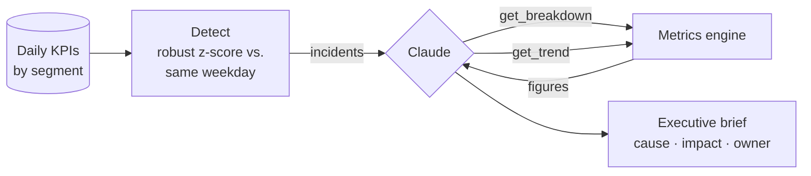

# KPI Insights Agent


Every morning someone asks "why did revenue drop yesterday?". This agent answers before anyone asks:
it detects anomalies in daily KPIs, drills into channels, regions and platforms to find the cause,
and writes an executive brief with impact and next steps. It can run on a schedule in GitHub Actions.

## How it works



**Code finds the anomalies and computes every number; the model forms and tests hypotheses and
writes the brief.** This keeps the figures trustworthy and uses the LLM where it adds value.

- **Detection** ([`metrics.py`](src/kpi_agent/metrics.py)): each day is compared with the same weekday
  over the previous 6 weeks using median and MAD, so weekly seasonality and earlier incidents don't
  cause false alarms
- **Root-cause drill-down**: additive metrics split by each segment's share of the change; ratio
  metrics (conversion, AOV) isolate segments whose *rate* changed from pure mix shifts
- **Agent** ([`agent.py`](src/kpi_agent/agent.py)): Claude tells tracking outages, checkout bugs and
  campaigns apart by checking how sessions, orders and conversion moved together
- **Rule-based fallback**: `--no-llm` produces a templated brief from the same analysis
- **Scheduled runs**: [`daily-brief.yml`](.github/workflows/daily-brief.yml) runs every weekday morning
- **Validated**: tests check it finds all three planted incidents (iOS checkout bug, Android
  tracking outage, paid-search campaign), raises no false alarms, and identifies the right segment

Sample output: [`reports/sample_brief_rules.md`](reports/sample_brief_rules.md)

## Run it

```bash
make setup                 # install dependencies (requires uv)
cp .env.example .env       # add ANTHROPIC_API_KEY (a .env in any parent folder also works)
make data                  # 5 months of daily KPIs with three planted incidents
make brief                 # Claude investigates and writes reports/brief_<date>.md
make brief-rules           # same analysis, rule-based wording, no API key
make test
```

## Data

Synthetic daily sessions, orders and revenue for 4 channels × 3 regions × 3 platforms with weekly
seasonality, growth and realistic noise. Planted incidents (and the expected answers) are saved to
`data/incidents.json`, so detection quality can be measured. To use your own data, provide
the same columns: `date, channel, region, platform, sessions, orders, revenue`.

**Stack:** Python · Claude API (tool use) · pandas · Rich · pytest · GitHub Actions (scheduled)
